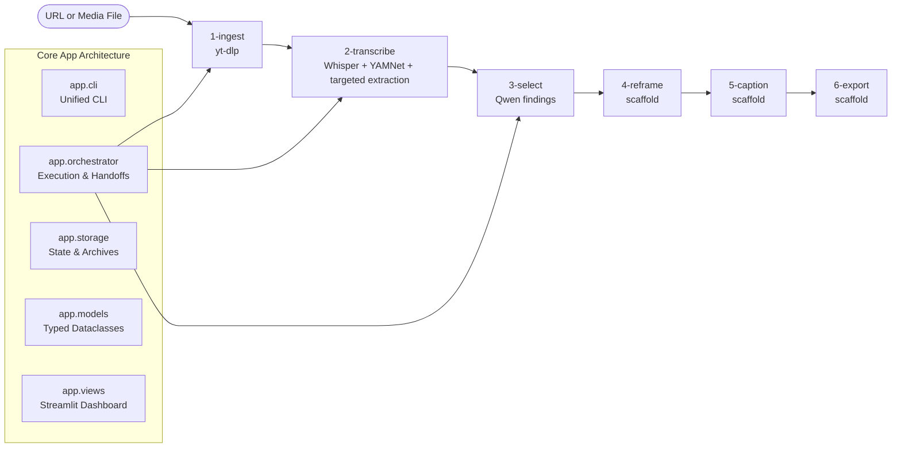

# clip2

Production-grade stage-based audio transcription, YAMNet tagging, and LLM clip selection pipeline.



## Stages

Each stage contains `input/`, `output/`, `services/`, and `scripts/`.

| Stage | Purpose |
| --- | --- |
| `1-ingest` | Download video + normalize source audio to 16 kHz mono WAV |
| `2-transcribe` | Whisper transcription, YAMNet tagging, timestamped TXT/VTT/JSON, and targeted transcript extraction |
| `3-select` | Qwen selection plus optional VLM contact-sheet visual analysis |
| `4-reframe` | Reframe selected clips (scaffold) |
| `5-caption` | Render captions onto video (scaffold) |
| `6-export` | Final video packaging (scaffold) |

## Quickstart

### 1. Unified Command Line Interface (CLI)

```bash
# Run full pipeline with a YouTube URL or local file
python3 -m app.cli run pipeline --target "https://www.youtube.com/watch?v=..."

# Run an individual stage
python3 -m app.cli run 2-transcribe --run-id <run_id>

# Extract YAMNet-targeted transcripts on the transcribe stage
python3 -m app.cli extract <run_id>

# Run Qwen selection over the extracted transcripts
python3 -m app.cli select <run_id>

# Generate contact sheets and run VLM visual analysis
python3 -m app.cli visual <run_id>

# Migrate or cleanup workspace files
python3 -m app.cli layout migrate --run-id <run_id>
python3 -m app.cli layout cleanup --run-id <run_id>
```

### 2. Streamlit Web Monitor

```bash
app/run.sh
```
Opens the web monitor on `http://127.0.0.1:8501/` to visualize audio activity heatmaps, inspect transcripts, run targeted extraction, Qwen selection, VLM contact-sheet review, and configure settings.

## Visual analysis

Selected clips can be reviewed as per-clip 2x3 contact sheets. Frames are extracted from archived video,
stored under `3-select/output/<run_id>/contact_sheets/`, and archived under
`app/history/<run_id>/selection/contact_sheets/`. Qwen VLM returns a chronological description,
visual score, transcript-support score, and flags.

The Select page finishes with a ranked **Best moments** table combining YAMNet trigger strength,
Qwen transcript match, VLM visual score, action/funny signals, and flags. The table is sortable.

The llama-server must be started with the model mmproj file to enable image input.

```bash
python -m app.cli visual <run_id>
```

## Qwen lifecycle

The Qwen server is managed automatically:

- Starting full transcription, transcribe re-run, or targeted extraction stops Qwen first.
- Starting Qwen selection or visual analysis starts Qwen if it is not already ready.
- Whisper and Qwen are never intentionally run together on the same GPU.

Server settings live under `[qwen_server]` in `config/local.toml`.

## Developer Quality & Verification

The project adheres to strict code quality standards:
- **Linting & Formatting:** `ruff check app tests` & `ruff format app tests`
- **Type Checking:** `mypy` type analysis on all core application modules
- **Automated Tests:** Comprehensive unit test suite covering audio DSP, VTT cues, layout, CLI, LLM selection, and analytics.

```bash
# Run all quality checks
make check

# Run test suite with coverage
make coverage

# Format codebase
make fmt
```

## Directory Structure

```text
├── app/
│   ├── cli.py             # Main CLI entrypoint
│   ├── models.py          # Typed domain dataclasses
│   ├── orchestrator.py    # Pipeline execution & stage coordination
│   ├── storage.py         # State, run pointers, & archival helpers
│   ├── archive.py         # Historical runs, targeted extraction, and selection persistence
│   ├── audio_utils.py     # Reusable audio DSP (WAV reading, RMS dB, YAMNet classes)
│   ├── vtt_utils.py       # WebVTT formatting, cue timestamps, sanitization
│   ├── llm_select.py      # Qwen client & heuristic clip selection fallback
│   ├── selection.py       # Qwen findings over targeted transcripts
│   ├── targeted_extract.py # YAMNet-targeted transcript extraction
│   ├── visual.py          # Video frames, contact sheets, and VLM review
│   ├── vlm.py             # Vision-language analysis client
│   ├── views/             # Decomposed Streamlit view modules (History, Ingest, etc.)
│   └── streamlit_app.py   # Multi-page web dashboard router
├── 1-ingest/              # Stage 1: Video + audio ingestion
├── 2-transcribe/          # Stage 2: Whisper + YAMNet + targeted extraction
├── 3-select/              # Stage 3: Qwen selection + VLM visual review
└── tests/                 # Automated pytest unit test suite (60+ tests)
```
